# GitAway storyboard v2 — Take a trip. Leave a trail.

18 shots · 87 seconds · storyboard review before video

## 01. Fourteen tabs (0–5s)

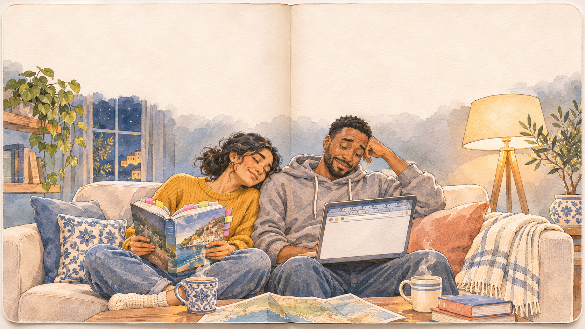

**Medium:** Watercolor

**Caption / optional narration:** Planning a trip shouldn’t feel like homework.

**Dialogue:** Maya: Fourteen tabs. Still no plan. | Sam: Where do we even start?

**Camera:** Slow dolly toward the sofa; browser tabs accumulate with quiet paper ticks.

## 02. Too much information (5–9s)

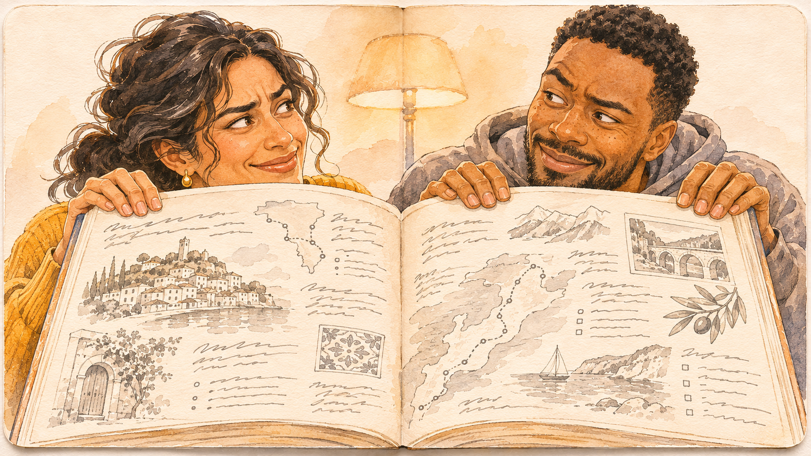

**Medium:** Watercolor

**Caption / optional narration:** All the information. None of the clarity.

**Dialogue:** Maya: Is this even up to date?

**Camera:** Push into the guidebook; the type becomes a maze of ink lines.

## 03. The first tap (9–13s)

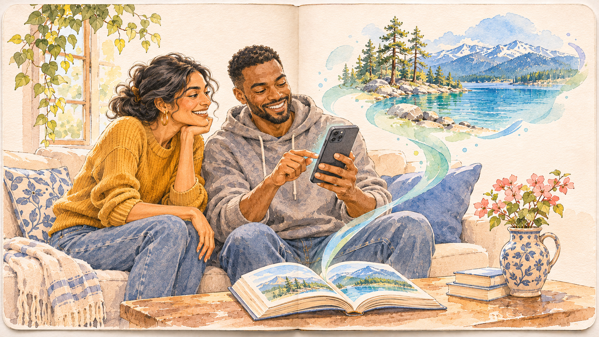

**Medium:** Watercolor

**Caption / optional narration:** Start with somewhere you want to go.

**Dialogue:** Sam: Tahoe? | Maya: Let’s do it.

**Camera:** Follow Sam’s finger; ink from the book lifts toward the phone.

## 04. Everything in view (13–19s)

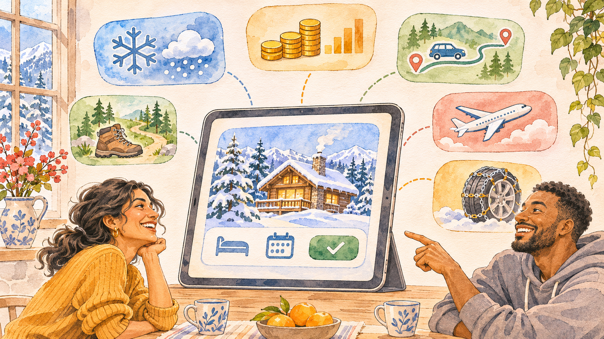

**Medium:** Watercolor + product

**Caption / optional narration:** The whole decision, in one place.

**Dialogue:** Maya: Snow chains. Good to know. | Sam: And the whole trip cost.

**Camera:** Cards unfold from the tap, then settle; the map keeps its place.

## 05. Book with a partner (19–24s)

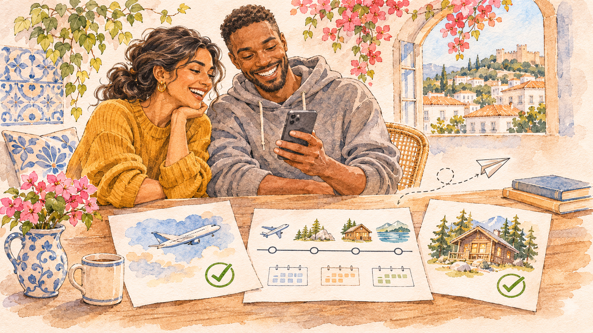

**Medium:** Watercolor + product

**Caption / optional narration:** Book with the partner. Keep the plan together.

**Dialogue:** Maya: Booked. | Sam: Now the fun part.

**Camera:** Partner handoff, then a confirmation returns to the shared trip.

## 06. The page gains depth (24–28s)

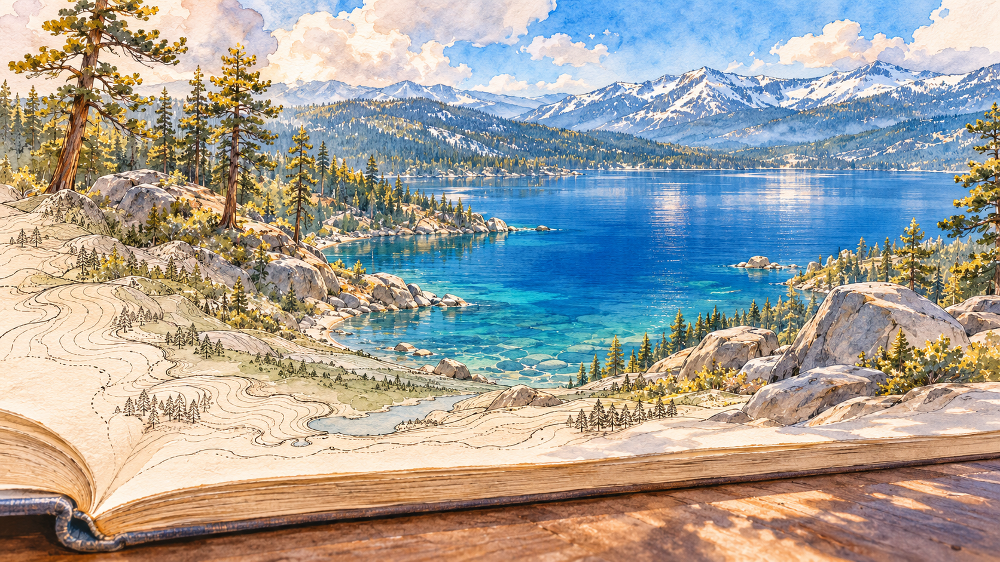

**Medium:** 3D transition target

**Caption / optional narration:** And then… step inside.

**Dialogue:** None — environmental sound.

**Camera:** Camera lowers from overhead to grazing the page; contours lift into actual terrain.

## 07. Fly into Tahoe (28–34s)

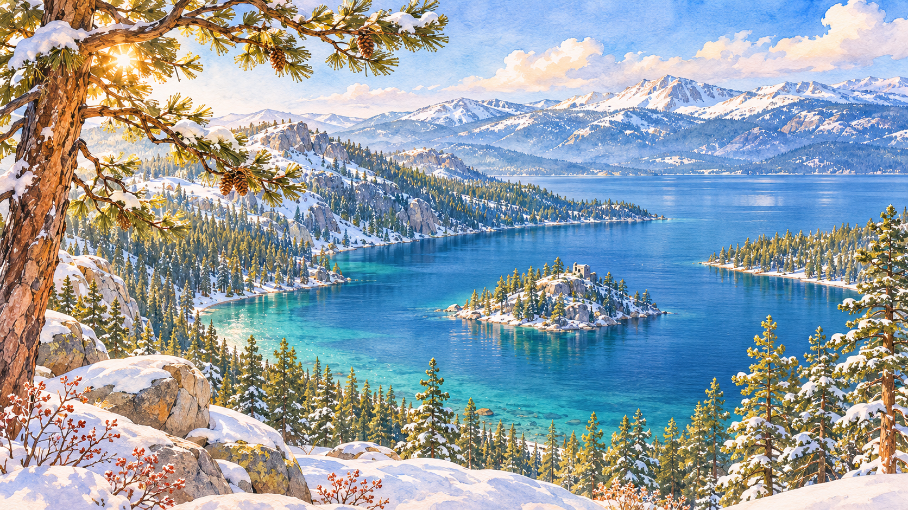

**Medium:** 3D flythrough target

**Caption / optional narration:** Then go.

**Dialogue:** None — environmental sound.

**Camera:** One unbroken glide over Emerald Bay; descend toward the south shore. Hold the view without UI.

## 08. Arrive at human height (34–39s)

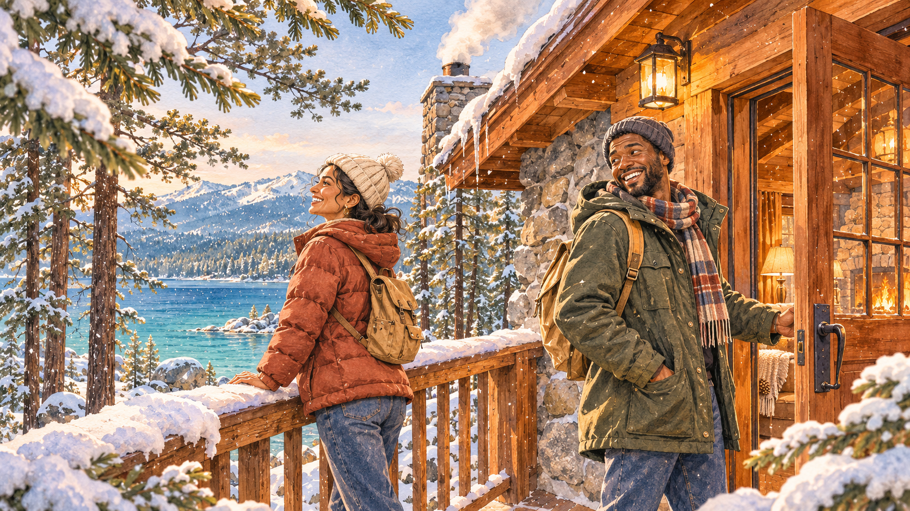

**Medium:** 3D arrival target

**Caption / optional narration:** A place you can almost feel.

**Dialogue:** None — environmental sound.

**Camera:** Pass between foreground pines; ease to eye height beside the cabin. Snow drifts across the lens.

## 09. The little moments (39–44s)

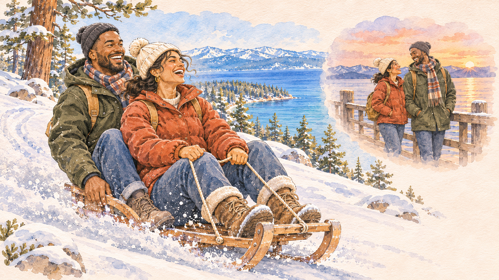

**Medium:** Watercolor

**Caption / optional narration:** The moments are yours.

**Dialogue:** Maya: Faster, Sam!

**Camera:** A sled passes close; match-cut to the same two silhouettes at a sunset pier.

## 10. Bring it home (44–48s)

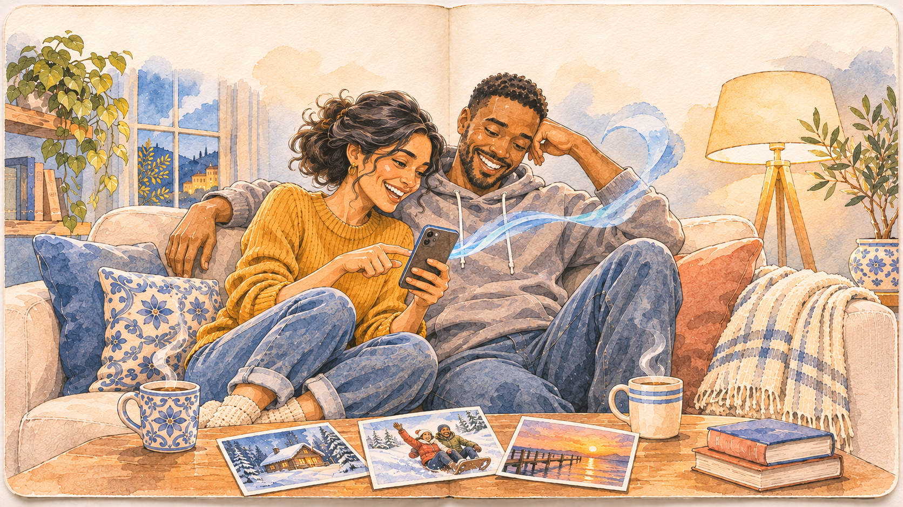

**Medium:** Watercolor

**Caption / optional narration:** Bring home more than photos.

**Dialogue:** Maya: Look at this one. | Sam: Best trip ever.

**Camera:** Match-cut the sunset photo to the phone back on the sofa.

## 11. Leave a trail (48–53s)

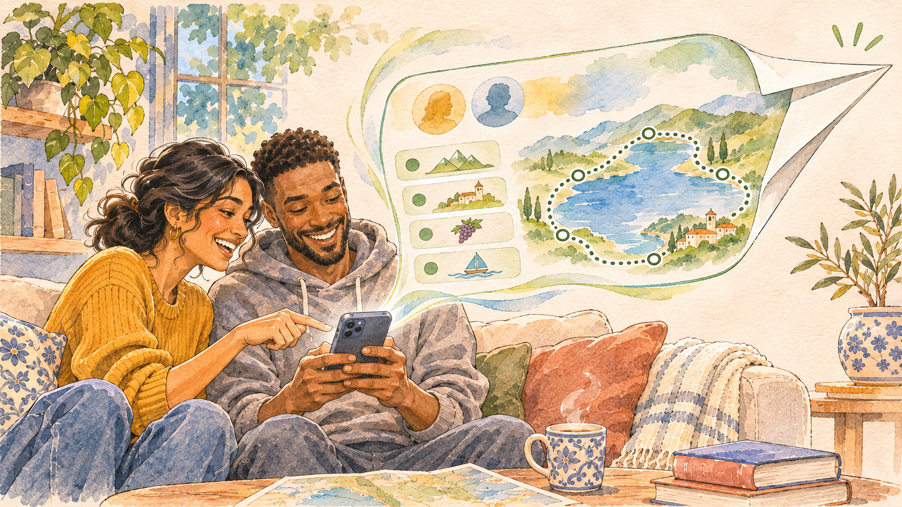

**Medium:** Watercolor + product

**Caption / optional narration:** Share the plan. Choose what stays private.

**Dialogue:** Maya: Someone should have this. | Sam: Leave a trail.

**Camera:** Route stays crisp; personal details dissolve; the plan folds into a paper plane.

## 12. A trail crosses the world (53–57s)

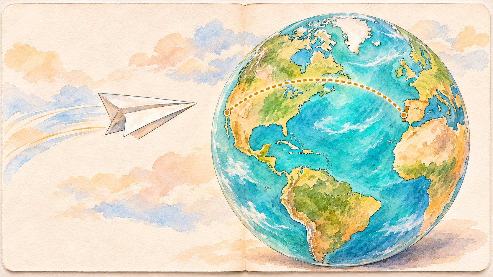

**Medium:** Globe transition

**Caption / optional narration:** A good trip can start another.

**Dialogue:** None — environmental sound.

**Camera:** Follow the paper plane; the globe rotates from the US west coast toward Portugal.

## 13. A nudge in Lisbon (57–61s)

**Medium:** Watercolor

**Caption / optional narration:** Half a world away…

**Dialogue:** Rosa: Tomás, look at this. | Tomás: A trail?

**Camera:** Globe lands on Lisbon; a quiet phone vibration answers the paper-plane sound.

## 14. Make it their summer (61–67s)

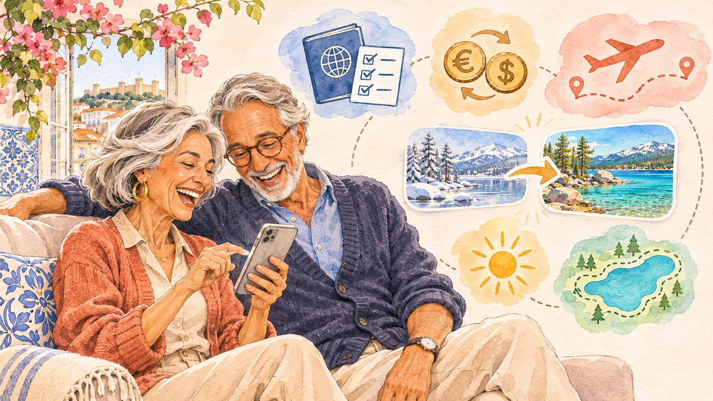

**Medium:** Watercolor + product

**Caption / optional narration:** Follow the trail. Make it yours.

**Dialogue:** Rosa: Summer at the lake? | Tomás: This is perfect.

**Camera:** Winter trip changes to summer; contextual cards appear around their phone.

## 15. Couch to beach (67–72s)

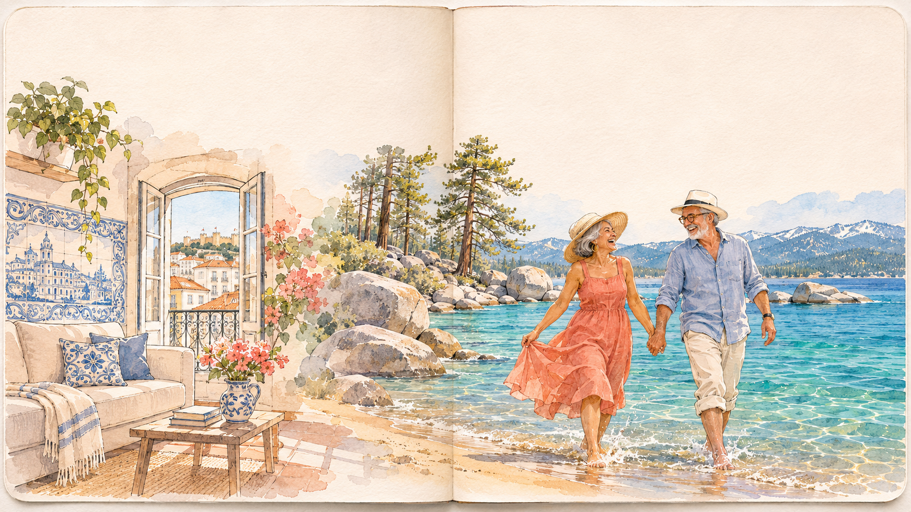

**Medium:** Approved watercolor

**Caption / optional narration:** Same trail. Their summer.

**Dialogue:** Rosa: Your shoes, Tomás! | Tomás: Cold! Perfect.

**Camera:** The room washes into Sand Harbor, keeping their eyeline continuous.

## 16. Summer, from inside it (72–78s)

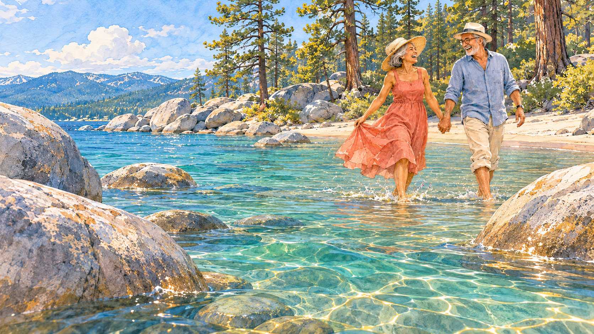

**Medium:** 3D summer target

**Caption / optional narration:** The same place. A whole new feeling.

**Dialogue:** None — environmental sound.

**Camera:** Match the winter camera line, now glide low past Sand Harbor boulders; land at water height.

## 17. The world keeps sharing (78–83s)

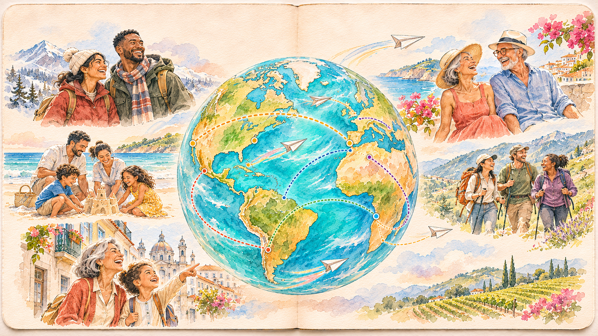

**Medium:** Watercolor + globe

**Caption / optional narration:** Every trail starts with someone.

**Dialogue:** Rosa: Obrigada.

**Camera:** Pull back from their lake to the globe; trails draw outward and continue beyond the frame.

## 18. An invitation (83–87s)

**Medium:** Typography + globe

**Caption / optional narration:** Take a trip. Leave a trail.

**Dialogue:** None — environmental sound.

**Camera:** The world settles; the tagline and one clear invitation remain.

## Production status

Generated artwork and camera targets, not a finished animated film. The existing Three.js Tahoe world provides a 3D foundation; the watercolor treatment and summer scene still need production work. Keep narrator and character dialogue as alternative cuts until the script is locked.
