# GitAway reskin: Direction A and Direction B

Design artboards only; no app code changed. Open `a.html` or `b.html` straight from this folder (no server needed). Each page shows all six screens with phone (390) and desktop (1440) frames, plus a Light/Dark switch. Any single screen opens at real size with `a.html?bare=1&screen=day&size=ph&mode=dark` (screens: `landing signin day book trip creators`; `&theme=scrapbook|structured|magazine` for `trip`). PNGs are in `png/`, named `<direction>-<screen>-<width>-<mode>.png`, and today's app is in `png/today/` for comparison. Built in omxqua v0.1.6 (Material texture, Liquid motion), following `~/.claude/design-taste.md`.

## The two directions

| | **A · Gallery** | **B · Ticket** |
|---|---|---|
| Idea | An Apple-style neutral grey canvas. Everything placed on it is a solid, saturated widget. | Warm paper and ink. The kinds are soft tonal containers, and the trip is printed like a ticket. |
| Accent | **Ink**: a black pill in light mode, a white pill in dark mode. The trip's kinds supply all the colour. | **Git vermilion** `#C93A1D` (light) / `#FF7A59` (dark): git's own orange-red, the brand's family, and a colour no booking site uses. |
| Widgets | Solid kind fills with white text (ride is yellow with dark text), no shadow, like phone home-screen widgets | A tonal container with dark kind ink, plus a solid kind tile for the icon |
| Type | Geist for everything, display 760 weight, tracking −5.8 % | Fraunces for headings and big numbers (times, prices, °), Geist for reading |
| Focal card | Up next is the one inverse card (ink in light mode, white in dark mode) | Up next, the total and the checklist are ticket stubs: a dotted perforation and two punched notches |
| Phone nav | A floating tab bar with frosted glass (omxqua's single glass exception, 2026-10-21) | A solid Material bar flush with the bottom edge and a tonal pill behind the active tab |
| Laptop shell | Top islands: brand · nav pill · Beacon (live flight) | Same layout, solid, tinted active pill |

| Day, phone | A light | A dark | B light | B dark |
|---|---|---|---|---|
| | 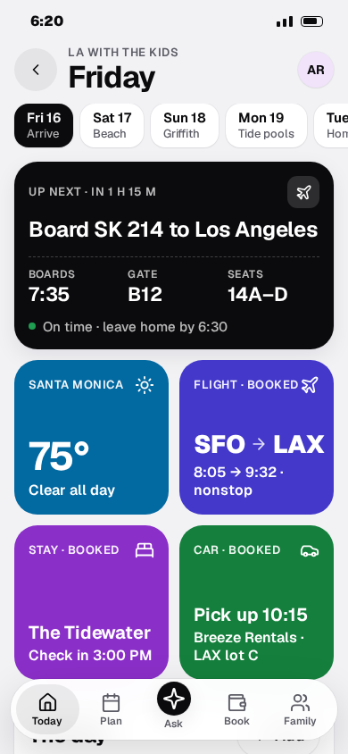 | 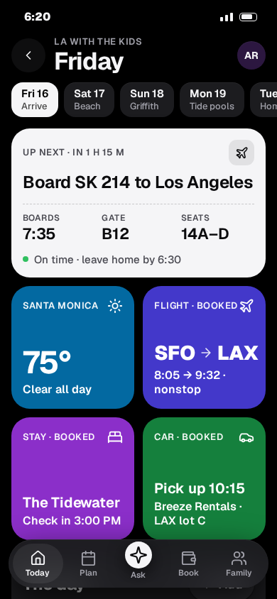 | 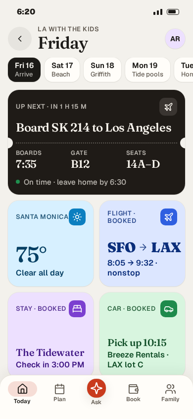 | 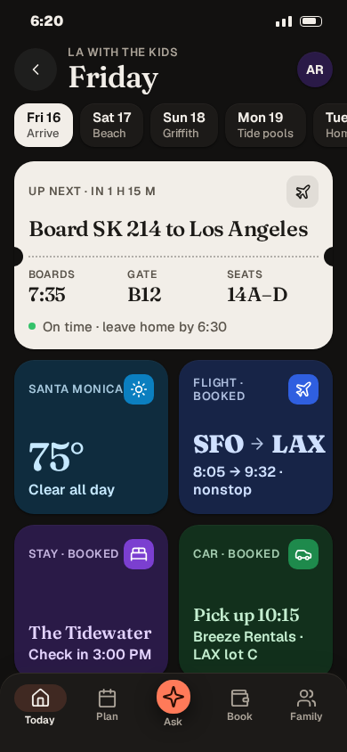 |

| Booking, desktop | A | B |
|---|---|---|
| Light | 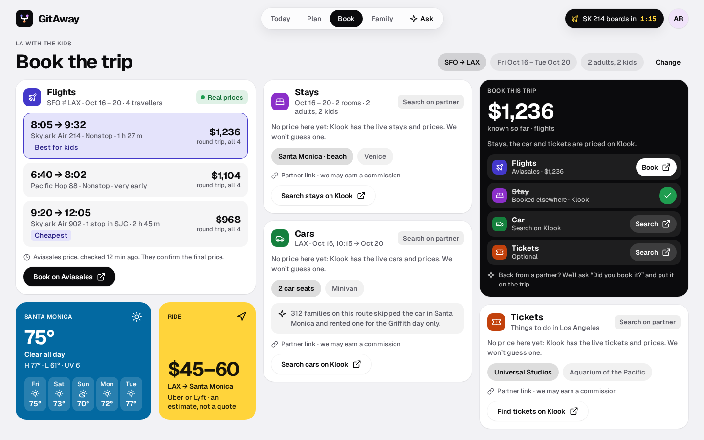 | 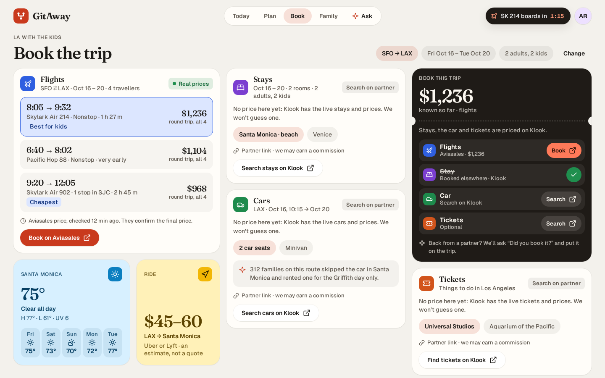 |
| Dark | 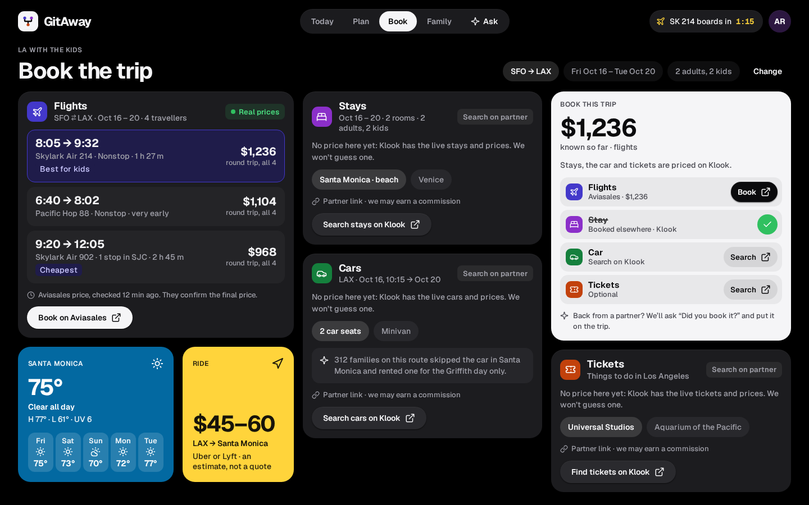 | 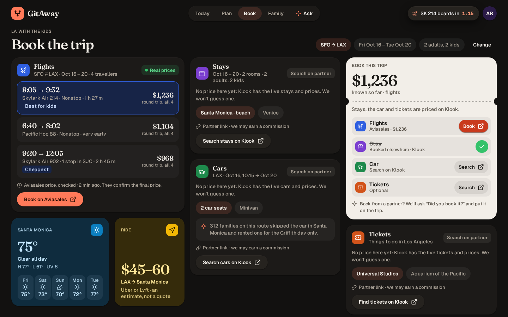 |

| Plan themes (A, desktop) | Scrapbook | Structured | Magazine |
|---|---|---|---|
| | 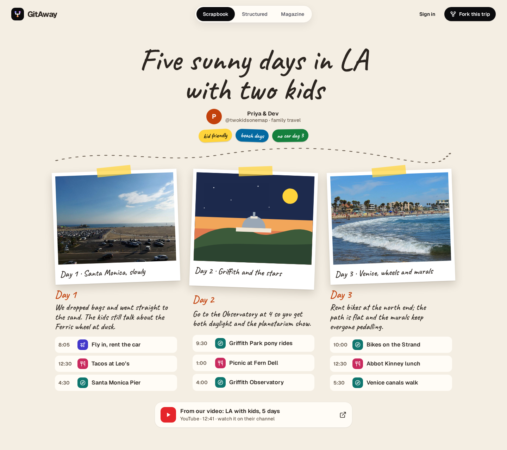 | 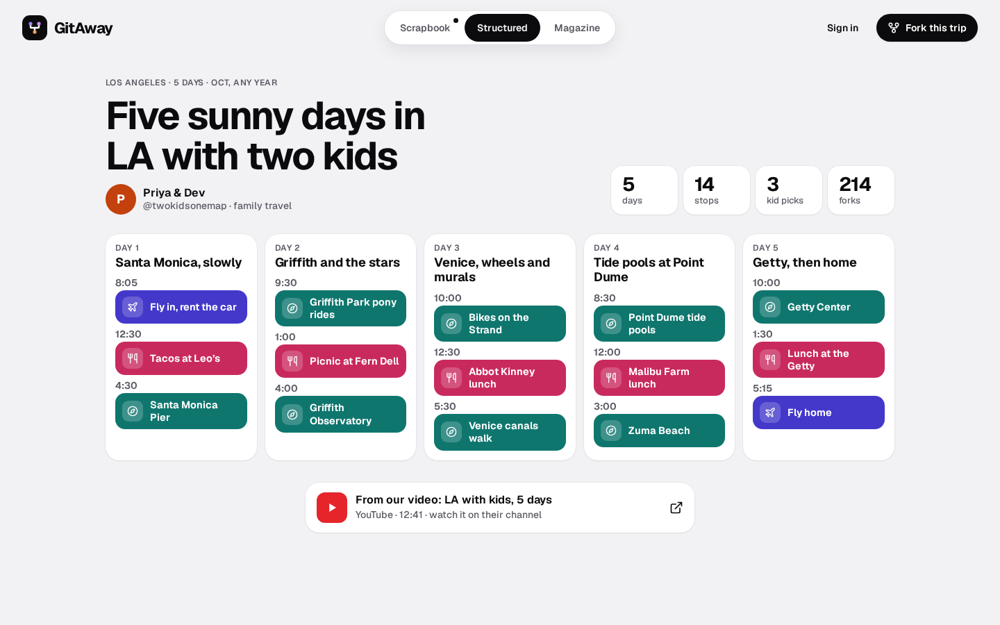 | 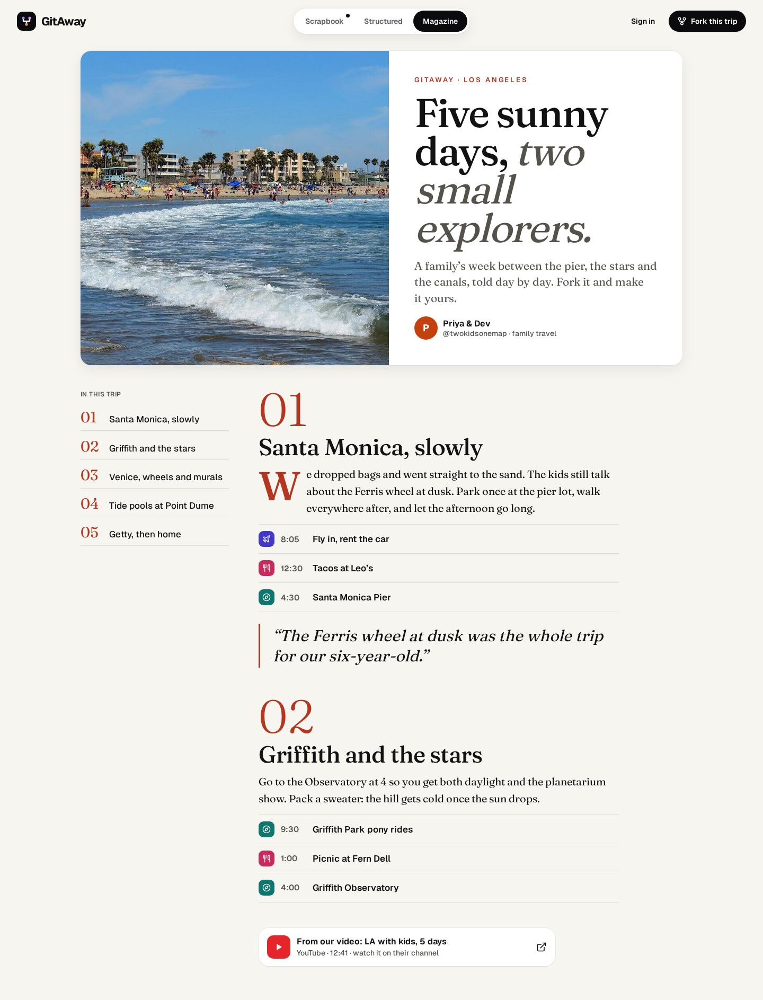 |

All 64 PNGs: 2 directions × 8 screens (landing, sign-in, day, booking, the trip in 3 themes, for creators) × 390 and 1440 × light and dark. The landing page, booking on the phone, the trip themes and For creators are full-page captures; sign-in, the day and booking on desktop are one screen each (desktop booking fits 1440×900).

## The six screens (same content in both directions)
1. **Landing (signed out)**: a huge two-tone "Fork a getaway." headline and two doors: *We're going* (from, to, when, who → Plan this trip) and *Show me a trip* (three creator trips). Then a widget bento, the three plan looks, and "Not another travel site" (we don't sell trips, no made-up prices, real trips you can fork). On the phone, each section is a heading plus one picture, and side-by-side cards scroll sideways with the next card peeking.
2. **Sign-in**: 34 px title, 17 px body, two 56 px buttons (Continue with Google, Sign in with a passkey). The trip being saved is shown as a card, so it's clear what signing in is for. On desktop, the trip's widgets sit on the left half.
3. **A trip's day**: on the phone, day chips (neutral, the selected one ink), Up next, Weather, Flight, Stay and Car widgets, then the day on a time rail with blocks filled in each kind's colour. On desktop, the hour grid on the left and the widgets on the right, all inside 1440×900.
4. **Booking panel**: weather gets its own widget. **Flights show a real-price state** (three fares, "Real prices", "Aviasales price, checked 12 min ago. They confirm the final price."). **Stays, Cars and Tickets show honest "Search on partner" cards** ("No price here yet: Klook has the live prices. We won't guess one.", the search we'll run, "Partner link · we may earn a commission"). Ride shows "an estimate, not a quote". The **Book this trip** checklist (F-180) shows the known total, one row per kind, the stay in its *Booked elsewhere · Klook* state, and the "Did you book it?" promise. On the phone, the total is pinned to the top.
5. **A creator's public trip, in three themes**, switched with a segmented picker (a dot marks the creator's pick):
   - **Scrapbook**: kraft paper, taped polaroids, Caveat handwriting, stickers, a dotted route squiggle.
   - **Structured**: a stats strip and five day columns, every stop on a time rail with kind-filled blocks.
   - **Magazine**: a cover photo, a Fraunces headline, a contents list, numbered day spreads, a drop cap and a pull quote.

   Every theme ends with the source card that links back to the creator's video. On the phone, a Fork bar is pinned to the bottom.
6. **For creators**: "Your post, forkable." with the paste box, the drafted trip as proof, the three reasons (under a minute, flights pay you, it links back to you), "Pick the look" and the terms in plain words.

## Tokens

### Colour: surfaces and text
| Token | A light | A dark | B light | B dark |
|---|---|---|---|---|
| canvas `--bg` | `#F2F2F5` | `#000000` | `#F3F1EC` | `#121110` |
| card `--s1` | `#FFFFFF` | `#1C1C1F` | `#FFFDF9` | `#1C1A18` |
| raised `--s2` | `#FFFFFF` | `#2A2A2E` | `#FFFFFF` | `#26231F` |
| ink | `#0B0B0D` | `#F5F5F7` | `#1C1A17` | `#F2EEE8` |
| ink-2 | `#5C5C66` | `#A1A1AA` | `#625B52` | `#ABA398` |
| line | `#E3E3E8` | `#2E2E33` | `#E6E0D6` | `#322E29` |
| accent / on accent | `#0B0B0D` / `#FFF` | `#F5F5F7` / `#0B0B0D` | `#C93A1D` / `#FFF` | `#FF7A59` / `#2A0E05` |

### Colour: kinds (colour means a kind, never a day)
| Kind | A fill (white text) | B tile fill | B container light / ink | B container dark / ink |
|---|---|---|---|---|
| Flight | `#4338CA` | `#2F5FE0` | `#DCE6FF` / `#0B2E7A` | `#172447` / `#CFE0FF` |
| Stay | `#8B2FC9` | `#7B3FD0` | `#EDE0FF` / `#3F1784` | `#2A1A47` / `#E4D4FF` |
| Car | `#15803D` | `#1E8A4C` | `#D8F5DF` / `#0F4D26` | `#12301C` / `#C4EED0` |
| Tickets | `#C2410C` | `#D2541B` | `#FFE4D2` / `#7A2E06` | `#3A2012` / `#FFD6BC` |
| Weather | `#0369A1` | `#0B7FC0` | `#D7F0FF` / `#063F63` | `#0F2C3E` / `#C6E9FF` |
| Food | `#C92A5E` | `#D13A6A` | `#FFDDE6` / `#7D1236` | `#3A1420` / `#FFD0DC` |
| See / do | `#0F766E` | `#0F8A80` | `#D5F2EE` / `#0B4A45` | `#0F2D2A` / `#BDEDE6` |
| Ride | `#FFD43B` (dark text `#17140A`) | `#F2B705` | `#FFF1B8` / `#5C4300` | `#352B0B` / `#FFE89A` |

Contrast was checked on every pair: A's white-on-fill ratios run from 5.0:1 (car) to 7.9:1 (flight), and ride's dark-on-yellow is 12.9:1. B's container ink is 7.8:1 or higher, ink-2 is 5.9:1 or higher, and the vermilion accent is 5.1:1 (4.5:1 when used as text on paper). A's dark-mode tints (used for the selected fare and booked rows) are listed in `a.css`.

### Type scale
| Role | Phone | Desktop |
|---|---|---|
| Hero (landing, creators) | 56–60 | 104–136, line height 0.92 |
| Section title | 36 | 64 |
| Title 1 (day, sign-in, booking) | 34 | 40–44 |
| Title 2 (Up next) | 24 | 22 |
| Title 3 (widget name, card head) | 20 | 18 |
| Widget big number (°, price) | 44 | 40 |
| **Body** | **17** | 16 |
| Secondary (sub-lines, chips, fine print on cards) | **16** (fine print 14) | 14 (13) |
| Label (all-caps eyebrows only, never sentences) | 13 | 12 |

The phone's minimum is 16 px for anything you read as a sentence. Square widgets on the phone drop their third line instead of shrinking it. Tap targets: every button, chip row, day chip, tab and list row is at least **48 px** on the phone (primary buttons 56 px, tabs 56 px inside a 68 px bar).

### Radii
| | A | B |
|---|---|---|
| Widget | 26 phone / 22 desktop | 22 |
| Card | 20 | 18 |
| Field | 14 | 12 |
| Landing door | 32 | 28 |
| Kind tile | 11 (sm 9) | 11 (sm 9) |
| Tappable | pill (999) | pill (999) |
| Status tag | 6 | 6 |

Inner corners follow the concentric rule: inner radius = outer radius − padding.

### Shadow (one scale, no blur or glass on cards)
| | Light | Dark |
|---|---|---|
| sh1 (cards) | `0 1px 2px rgba(10,10,20,.06), 0 0 0 1px rgba(10,10,20,.04)` (B uses warm `40,30,20`) | `0 1px 0 rgba(255,255,255,.05) inset, 0 1px 2px rgba(0,0,0,.6)` |
| sh2 (focal, menus) | `0 8px 24px …08` + ring | `… 0 8px 24px rgba(0,0,0,.6)` |
| sh3 (tab bar, sheets) | `0 18px 48px …16` + ring | `… 0 18px 48px rgba(0,0,0,.75)` |

In A, the coloured widgets carry no shadow (colour is depth enough); only white cards and the focal card do.

### Motion (Liquid, by omxqua's motion budget)
- **Phone:** a tapped widget grows into its sheet from where it sits (settle tier: 12 px rise, 280 ms, decelerating, no bounce) and folds back into it. Day-chip and tab thumbs slide on `--oq-spring-fast` (k380 c30). Every tappable element squashes to 0.96 when pressed. Live values (boarding countdown, the total) update in place and never bounce. A's tab bar shrinks to icons while you scroll down. B's signature move: marking a booking done tears the stub along its perforation (the lower half slides 12 px and fades) and the row settles into "Booked elsewhere".
- **Laptop:** the same calls run as a calm 180 ms fade, with no zoom or tearing. The Beacon morphs open into the flight card on a no-overshoot spring.
- **Landing:** the hero words rise in once (staggered 70 ms) and sections rise 28 px as they enter; B writes the italic "getaway." in stroke-then-fill. With reduced motion, everything is static.

## What changes vs today (`png/today/`)
- **Canvas:** cream `#FFF8EE` and coral blocks become a neutral grey canvas (A) or a warm paper canvas (B), with dark modes designed from the start.
- **Type:** on sign-in, body text goes from 16 px to 17 px, the fine print and "Sign-in isn't set up" lines from about 14 px to 15–16 px, and buttons grow to 56 px; app sub-lines go from 12–13 px to 16 px on the phone. Labels are no longer mono and no longer used for sentences. Bricolage and Figtree are replaced by Geist (A) or Fraunces with Geist (B).
- **Booking:** today it's long scrolling columns of identical white cards with a "Book on …" link under each. It becomes widgets: weather, a real-price flight card, honest "search on partner" cards for stays, cars and tickets, a ride estimate, and one Book this trip checklist (no Book button per card, per F-180).
- **The day:** a strong Up next card plus kind widgets above the time rail. Plan blocks are filled with their kind's colour (already your rule) and are bolder in A.
- **Plans get themes:** the single scrapbook layout becomes three looks (Scrapbook, Structured, Magazine) on the same data. The creator picks one and readers can switch.
- **Brand:** A turns the mark into an ink tile with the fork's three nodes in the kind colours, so the colour belongs to the trip. B keeps an orange-red tile but moves it from coral `#FF7352` to git vermilion, which also steps away from Airbnb's coral.
- Unchanged: the content, the routes, the honesty rules (partner links, commission line, no invented prices), and colour for kinds, never days.

## Recommendation
**Build Direction A, and borrow one thing from B: the ticket-stub perforation on Up next and the Book this trip checklist.** A is what you described: a quiet grey canvas where every widget is a bright, high-contrast block, it reads at a glance on the phone, and its dark mode is the strongest of the four mode-and-direction combinations. Because the accent is ink, no button ever competes with the kind colours, and the multicoloured mark makes those colours the brand. B is the more distinctive and editorial option (its Fraunces numbers are lovely), but its tonal widgets are softer than "colorful and high-contrast", and an orange accent ties the new site back to the old look. The risk with A is that an ink accent can feel generic. The kind colours, the mark and the three plan themes are what keep it from looking like "another travel site", so the themes should ship with the reskin, not after it.

## Files
`a.html`, `b.html` (overview pages) · `screens.js` (one markup for both directions) · `base.css` (layout) · `a.css`, `b.css` (each direction's tokens and skin) · `viewer.js`, `viewer.css` · `assets/`: Geist, Geist Mono, Fraunces and Caveat (SIL OFL; licences alongside) and two CC0 area photos (see `assets/photos/CREDITS.md` in the app). The photos show the area, never a hotel or room. The creator, carriers and prices are sample data.
