# The 3D story: three prototypes

Throwaway design prototypes for "The soul: sharing" in `docs/briefs/free-and-polished.md`. No app code changed. Open `index.html`, or any prototype straight from this folder (`file://` works, no server): `diorama.html`, `postcards.html`, `globe.html`. Each one tells the same sample trip, *Five sunny days in LA with two kids* by Priya & Dev, in the same order:

1. the creator's name, a one-line story, and Thank and Fork,
2. the 3D scene, which plays once as a short film the first time it's on screen (pause button; any touch stops it), with day chips under it,
3. the day plan in Direction A: a time rail of kind-filled blocks, the weather, stay and car widgets, and a link-out **Book it your way** lane (Aviasales and Klook partner links, an Expedia plain link marked "we earn nothing"),
4. **Where this trip went**: a git graph of forks, and forks of forks.

Built in omxqua with Direction A's tokens (grey canvas, Apple-bright kind colours, ink accent, Geist; Caveat for the creator's own words), light and dark. Dark mode turns each scene to dusk: lamps, stars, a warm low sun. Everything is opaque; nothing is blurred.

URL switches: `?mode=light|dark`, `?day=1..5` (start on a day, no autoplay), `?noauto`, `?still` (force the calm still), `?capture` (story already played: all routes and forks shown).

## The two sharing moments (all three prototypes)
- **Thank** (like starring a repo): a tonal pill with a star and the count. Tapping it turns the pill ride-yellow, spins the star filled, rolls the count 1,284 → 1,285 on a spring, sends a burst of kind-coloured confetti from the button with a "+1", and makes the scene cheer: the family hops, confetti flies in 3D, the Ferris wheel spins faster, or the cards flutter. Tap again to undo. With reduced motion there's no burst, only the state and the count.
- **Fork**: the ink pill. Tapping it adds **You** as a new branch at the top of the git graph (the line draws itself), rolls 214 → 215, shows the toast "Forked. It's yours now. Priya & Dev see the thanks; you get a copy to change.", and the trip branches in the scene, toward a home guessed from your time zone only (no permission, nothing sent anywhere).

## The three concepts

| | Opening frame | What moves | How forks show |
|---|---|---|---|
| **1 · Toy diorama** | A low-poly tile of the LA coast: ocean, beaches, the Santa Monica Mountains, Griffith, the pier with a turning Ferris wheel, Venice canals, LAX, downtown | Each day's route draws itself across the map; pins pop up in kind colours as the line reaches each stop; a toy car with the family's four heads drives the line (on the no-car day, the family walks). Tap a day to fly there; tap a pin for the stop (it lights up in the plan). | At the end the camera pulls back and dashed roads run off the edge of the map, labelled "San Diego → 18 forks · Ana & Luis", "Disneyland →", "Universal →". Your fork adds a road in ink with "Your fork". |
| **2 · Memory postcards** | A cover card with Priya & Dev and the title, on a dotted path | Per day: an inverse chapter card (day, title, weather, kind dots), a sticky note in Caveat with the creator's tip, then a polaroid per stop (the two real CC0 photos, or a small flat illustration: tacos, the observatory at dusk, tide pools with starfish, the Getty) and boarding-pass stubs for flights (B's perforation). Drag to glide down the path; it snaps to days. A paper plane leads and loops when the day changes; cards fold away as you pass; tap a card to bring it close. | The path splits after the last day into dashed fork cards; your fork branches off where you are with an ink "Your copy · change anything" card. |
| **3 · Globe to street** | A toy globe (rough hand-drawn continents, raised land, deserts, ice, drifting clouds) spinning | It turns to LA while the family's plane flies the arc in from Chicago, dives in (a quick opaque dip), and lands on five day islands on a turntable: the pier with its wheel, the observatory hill with a pony and a picnic blanket, Venice canals with bikes, rocks and tide pools with a lifeguard tower, the Getty with a tram and a jet taking off. Swipe turns the table; the family on each island hops as you arrive. | Zoom out at the end: arcs leave LA for Toronto, London, Mexico City and Sydney, each with a pin and a name. Your fork shoots a new ink arc to your city: "The trip just reached Seattle." |

| | Phone 390, light | Phone 390, dark | Desktop 1440 |
|---|---|---|---|
| Diorama | 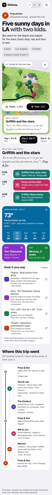 | 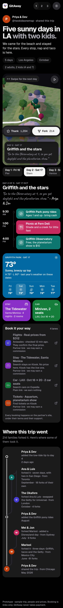 | 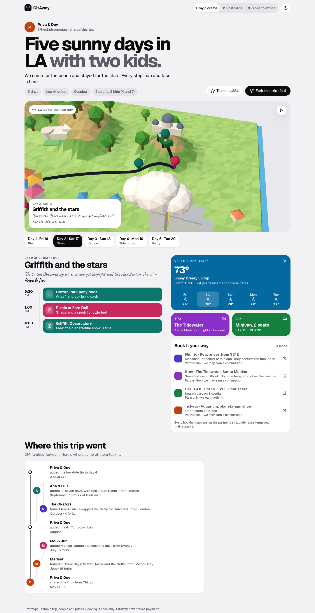 |
| Postcards | 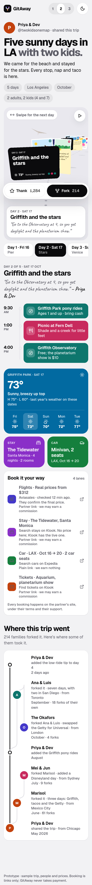 | 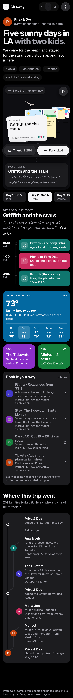 | 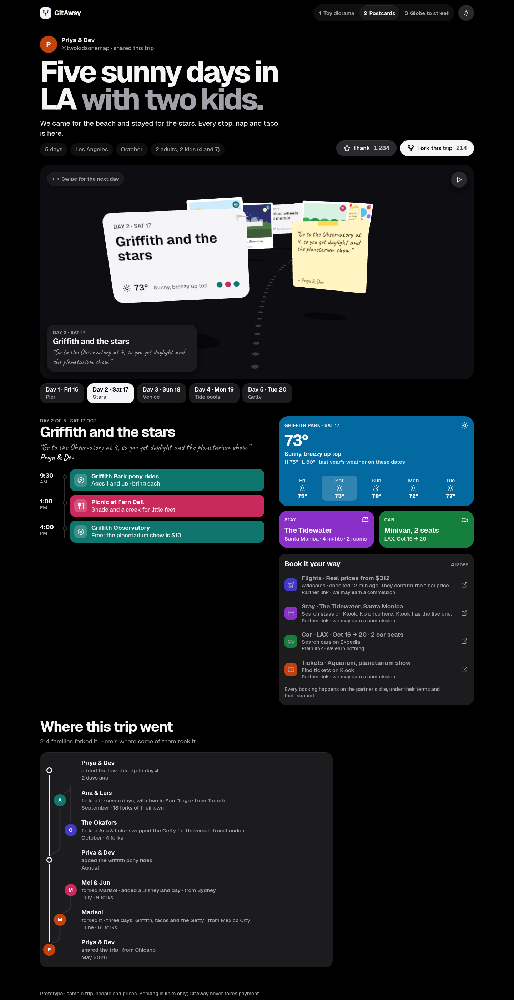 |
| Globe | 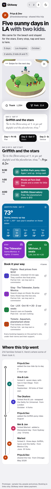 | 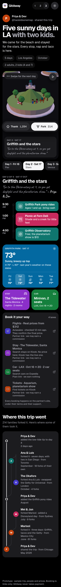 | 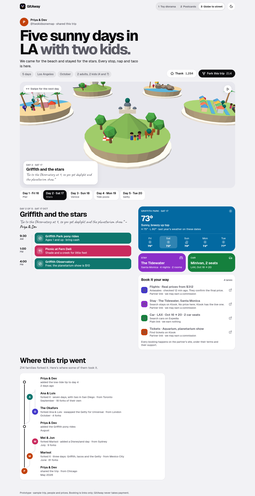 |

Motion (phone, the film playing, then Thank, then Fork): `motion/diorama.mp4`, `motion/postcards.mp4`, `motion/globe.mp4`, and a frame strip of each:

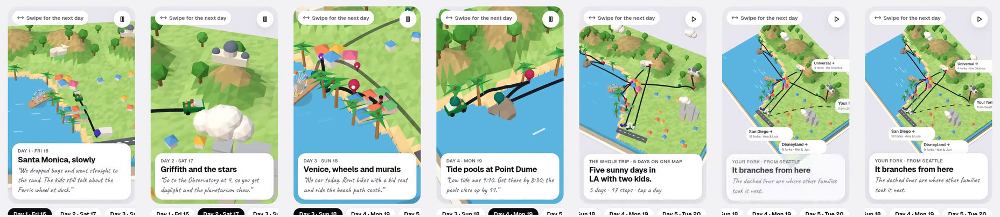
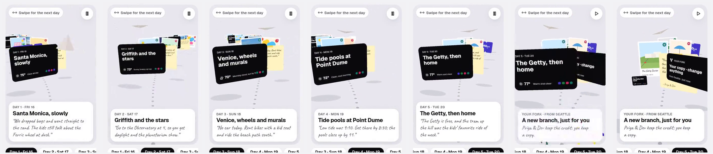
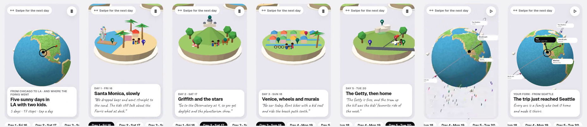

The two moments, phone: `png/<concept>-390-thank.png` (the burst mid-flight) and `png/<concept>-390-fork.png` (the branch in the scene and the toast).

## Budgets: measured

### JavaScript (gzip -9, what a page downloads)
| Page | Page script `ui.js` | Scene script (three.js r187 tree-shaken inside) | **Total** | Brotli total |
|---|---|---|---|---|
| Diorama | 8.9 KB | 144.9 KB | **153.9 KB** | 128.4 KB |
| Postcards | 8.9 KB | 139.7 KB | **148.6 KB** | 124.3 KB |
| Globe | 8.9 KB | 146.2 KB | **155.1 KB** | 129.3 KB |

All three are under the 200 KB budget. three.js is most of each scene script: a probe bundle of just the three.js parts these scenes use came to 138 KB gzip, so the scene code itself is only a few KB. The scene script loads only when the stage comes within 300 px of the screen, and never with reduced motion or without WebGL. Postcards also loads `dist/photos.js` (52 KB raw, two downscaled CC0 photos as data URIs). That's image data, not code: a `file://` page can't hand image files to WebGL, so the prototype inlines them; in the app they'd be ordinary image requests. Run `node build.mjs` to rebuild and re-measure.

### Frame rate
`node tools/measure.mjs` (results in `tools/fps.json`): a 390×844 phone (DPR 3, capped to 2 by the scene, touch), Chromium CPU throttled 4×, 8 s of the film playing. It ran twice: on this machine's GPU (an RTX 3090 through Vulkan), and on SwiftShader, Chromium's software renderer, standing in for a weak phone GPU. Each run has the weak-device fallback switched off, so the numbers are raw.

| Prototype | GPU run: fps · p95 frame | Software GL run: fps · p95 frame · frames over 33 ms | Main-thread JS per frame (median / p95), 4× throttled |
|---|---|---|---|
| Diorama | **60** · 16.7 ms | **52** · 33.3 ms · 2.2% | 0.9 / 1.8 ms |
| Postcards | **60** · 16.7 ms | **58.5** · 16.8 ms · 0.2% | 3.2 / 5.2 ms |
| Globe | **60** · 16.7 ms | **60** · 16.7 ms · 0% | 1.1 / 2.4 ms |

An earlier software-GL run gave Postcards 50 fps (p95 50 ms): its photo and font textures upload in the first seconds, so it varies from run to run more than the others.

What this does and doesn't prove: 4× CPU throttling slows the page's JavaScript like a mid phone does, and the main-thread work per frame is well inside the 16.7 ms budget. This desktop GPU is far faster than a phone GPU, though, and SwiftShader isn't slowed by the throttle, so neither run is a real mid phone. **Next step: open the three files on the captain's own phone.** The fallback is built for exactly that case: after 90 frames, a median over 30 ms drops the pixel ratio to 1, and if it stays over 40 ms the story swaps to the still.

### The rules
- **Pause:** the render loop stops when the stage leaves the screen (IntersectionObserver) and when the tab is hidden (visibilitychange). Nothing runs while you read the day plan.
- **Calm still:** with `prefers-reduced-motion`, without WebGL, on a phone with ≤ 2 GB memory or ≤ 2 cores, or when the frame guard trips, the stage shows a still picture of the same scene (`stills/<concept>-<phone|wide>-<light|dark>.webp`, 15 to 52 KB, rendered from the real scene by `tools/capture.mjs`). Day chips, the plan, Thank and Fork all still work.
- **Touch first:** swipe the stage for days (postcards and globe follow your finger), tap pins and cards, 48 px targets and up, chips 56 px; nothing needs hover. The stage uses `touch-action: pan-y`, so vertical page scrolling never gets stuck.
- **Light and dark:** both are designed; the scene relights itself, and labels and cards redraw.
- **No blur or glass:** caption, share bar, toast and labels are opaque.

### Rough edges (prototype)
- Postcards on desktop: your fork's card lands partly behind the sticky note, and a passing chapter card can fill the left edge mid-glide.
- The globe's continents are hand-drawn and rough on purpose (a toy globe); the arcs to Sydney and London cross the back of the globe.
- In full-page phone PNGs the pinned share bar shows mid-page; that's how a full-page screenshot draws fixed elements. On a real phone it sits at the bottom.
- The weak-device guard and the calm still are built and checked with `?still`, but haven't been tried on a real weak phone.

## Licence finding: ThreeUI
`github.com/MengTo/threeui` (cloned to `~/.cache/threeui-src`, outside the repo) is **MIT licensed** (© 2026 Meng To). Its asset notes put the Community components' own imagery under MIT too, the bundled three.js stays MIT, and the fonts are OFL. It's a React and Vite component catalogue (50 Community components, an npm package `@designcodeio/threeui`, a paid CLI for Pro), not an agent skill. Nothing in it is a travel or map story, and its components assume React, so I took one piece and one idea and wrote the rest: Gallery's render lifecycle, adapted with attribution in `CREDITS.md`, and its curved floating panels as the seed of the postcards. No React and no ThreeUI assets.

## Recommendation
**Build Postcards (2) as the story, opened by Globe to street's first four seconds and closed by its fork arcs.** Postcards is the most personal (the creator's own photos and handwriting carry it), the lightest (148.6 KB, no map data), and it works for any trip on day one, because a creator only needs photos and notes, not a 3D model of the place. The globe's turn, fly-in and "the trip just reached Seattle" arcs are the best picture of the GitHub feeling in all three, and a globe needs only a latitude and longitude. The diorama is the most charming, the one that feels most like a Pixar short, but every destination would need its own hand-made or generated map tile. That's a project of its own: keep it for a flagship trip (the captain's Disneyland) later, not the default. Its weakest number is the frame rate on software GL, and Postcards' is the texture upload when the photos arrive.

## Files
- `index.html`: the three prototypes side by side. `diorama.html`, `postcards.html`, `globe.html`.
- `story.css`: Direction A tokens and the page. `src/`: `trip.js` (the sample trip, lane, forks, icons), `ui.js` (the page, Thank, Fork, the graph, loading the scene), `core.js` (stage, springs, merged props), `diorama.js`, `postcards.js`, `globe.js`.
- `dist/`: built classic scripts, the vendored three.js inside each scene script, and `photos.js`. `build.mjs` rebuilds them (`esbuild` and `three@0.187.0` from `~/.cache/story3d-build`, outside the repo).
- `tools/shot.mjs` (one screenshot), `tools/capture.mjs` (stills, page PNGs, moments, motion), `tools/measure.mjs` (fps), `tools/fps.json`.
- `png/`, `motion/`, `stills/`: captures. `CREDITS.md`: three.js, ThreeUI, fonts, photos.
